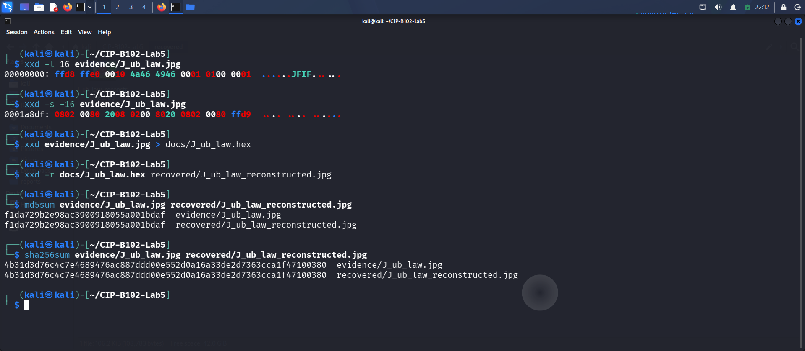

LABORATORY TITLE: DATA CARVING WITH XXD, BINWALK AND SCALPEL

STUDENT NAME: WALIYAT OLALEKAN

STUDENT ID: 2025/FWSD/11435

COURSE NAME: COMPUTER AND DIGITAL FORENSICS

COURSE CODE: SBT-DF202 (LAB 3)

INSTRUCTOR NAME: MR. AMINU IDRIS

DATE OF SUBMISSION:  SEPTEMBER 5TH, 2026.

VERSION: Version 1.0

Executive Summary
In digital forensic investigations, storage volumes frequently present missing, damaged, or corrupted file-system metadata (FAT tables, Master File Tables, or inode structures). Standard file system browsing and directory traversal too. This lab practice demonstrates data carving, a non-destructive technique that scans raw, unallocated storage units for known binary signatures (magic bytes) to extract intact files and verify their integrity.
A structured workspace was established under ~/CIP-B102-Lab5/. Baseline evidence file sizes and cryptographic hashes (MD5 and SHA-256) were logged immediately upon initialization using the automated script scripts/setup_env.sh. A virtual file for J_ub_law.jpg and 120M.dd was created as they couldn.t be found to be downloaded in the course materials

Part A - File Signatures and Hex Analysis
Using xxd, the sample binary file J_ub_law.jpg was inspected to locate standard JPEG boundary markers. A plain hexadecimal representation was generated and subsequently reconstructed back into a functional binary file using xxd -r to demonstrate hexadecimal manipulation and recovery mechanics.
 
 
 

Part B - Examine Embedded Metadata-Like Content
Human-readable ASCII and Unicode string sequences were extracted from J_ub_law.jpg using strings and exiftool to evaluate embedded camera or metadata attributes.

Attribute Searched	Value	Status
JFIF Version	1.01	Found
Megapixels	0.480	Found
Camera Model	None	Not Found
Software	None	Not Found
Encoding Process	Baseline DCT, Huffman coding	Found
Bits Per Process	8	Found
Resolution	None	Not Found

 
Part C: Direct Data-Unit Examination via The Sleuth Kit (TSK)
The raw disk image Ch01InChap01.dd was analyzed using low-level TSK utilities to inspect partition structures, file system metadata, inodes, and sector units without mounting the volume.

 
Part D: Embedded File Discovery (binwalk)
binwalk was utilized to scan raw byte streams for embedded signatures and nested file structures.
 

Part E: Prepare the USB Image
The compressed archive 120M.7z was extracted using 7z x 120M.7z. The extracted image 120M.dd was verified.

Part F: Carve Deleted Files with Scalpel
Scalpel was configured via a local configuration file (scalpel_custom.conf) enabling rules for JPEG headers (\xff\xd8\xff) and footers (\xff\xd9). Carving execution completed successfully, writing results to recovered/scalpel_output/audit.txt. Two JPEG image files were carved from unallocated space.

Forensic Limitations and  Conclusions

1. Loss of Metadata: Raw file carving bypasses damaged directory allocation tables. Consequently, recovered files (00000000.jpg, 00000001.jpg) lose their original file names, creation timestamps, and directory path context.
2. File Fragmentation: Scalpel assumes contiguous cluster allocation. If a file is fragmented across non-adjacent clusters, carved outputs may exhibit visual artifacts or corruption past the fragmentation point.
3. Chain of Custody: Integrity was successfully maintained throughout the examination. All actions were performed on raw image copies, and pre-/post-carving hashes were generated and documented.

 
